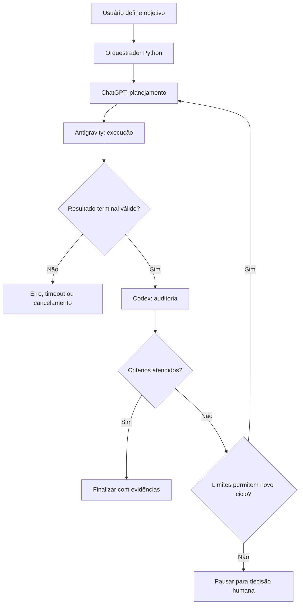

# Multi-IA Orchestrator

> **Status:** proposta aprovada; implementação ainda não iniciada.

## Visão geral

O **Multi-IA Orchestrator** é um aplicativo desktop Windows em Python que coordena o ciclo **ChatGPT (planejador) → Google Antigravity (executor) → OpenAI Codex (auditor) → avaliação e próxima iteração**, sempre com limites, rastreabilidade e controle humano.

O objetivo é substituir a transferência manual de prompts e respostas entre ferramentas, mantendo evidências da execução e permitindo pausar, parar e retomar com segurança.

**Estratégia híbrida:** priorizar API, SDK e CLI oficiais; considerar automação visual apenas quando necessária, permitida e validada.

## Objetivos

- Receber do usuário o objetivo e os limites de uma execução.
- Planejar instruções estruturadas para o executor.
- Aguardar o término verificável da execução no Antigravity.
- Solicitar auditoria e testes ao Codex.
- Devolver evidências ao planejador para decidir se encerra ou inicia outro ciclo.
- Registrar prompts, resultados, comandos, testes, falhas e decisões.
- Oferecer controles de início, pausa, retomada e interrupção.

## Fluxo

Resultados parciais não podem avançar o fluxo. Cada agente recebe um resumo verificável do trabalho anterior, não apenas uma repetição textual do prompt.

## Arquitetura

| Camada | Responsabilidade | Tecnologia prevista |
|---|---|---|
| Core Engine | Estados, transições e coordenação assíncrona | Python 3.12+, asyncio |
| Agent Adapters | Integração com modelos e interfaces | API / SDK / CLI; fallback visual |
| Task Manager | Timeouts, tentativas, cancelamento | asyncio, subprocess |
| Memory Manager | Histórico e checkpoints | SQLite, JSON |
| Workspace Manager | Isolamento e inspeção de mudanças | Git, worktrees |
| Safety Controller | Aprovações, limites, permissões | Regras explícitas |
| Observabilidade | Eventos e evidências | Logs estruturados |
| Interface gráfica (fase posterior) | Monitoramento e controles | PySide6 |

### Contratos de agentes

Cada etapa terá `run_id`, `cycle_id`, papel, tarefa, contexto, status, evidências, erros, arquivos e testes. Os contratos serão versionados e validados.

Estados terminais aceitos: `completed`, `failed` e `cancelled`; `pending` e `running` não equivalem a conclusão.

### Segurança e autonomia

- Um único agente pode modificar o workspace de cada vez.
- Ações destrutivas, alterações externas e publicação exigem aprovação humana.
- Nunca alterar produção automaticamente.
- Definir limites de ciclos, tempo, tentativas e orçamento.
- Não registrar credenciais nem alegar acesso a pensamentos internos de agentes.
- Interrupção impede novas etapas; recuperação não repete escrita incerta.
- Testar inicialmente com adaptadores simulados e repositórios descartáveis.

## Plano de implantação

A execução foi detalhada em [docs/superpowers/plans/2026-11-23-multi-ia-orchestrator.md](docs/superpowers/plans/2026-11-23-multi-ia-orchestrator.md).

| Etapa | Entrega |
|---|---|
| 0 | Descoberta e decisão de integração |
| 1 | Contratos e agentes simulados |
| 2 | Máquina de estados |
| 3 | Cancelamento, timeout e aprovações |
| 4 | Persistência e checkpoints |
| 5 | Isolamento e ciclo repetível |
| 6 | Integrações reais, condicionadas à Etapa 0 |
| 7 | CLI do MVP e ensaio completo |

A interface PySide6 e o empacotamento serão objeto de plano separado, após a validação do MVP.

## Critérios de sucesso

- Ciclo completo entre três agentes com evidências.
- Detecção confiável de conclusão, falha e timeout.
- Interrupção antes da próxima etapa.
- Checkpoint consistente e recuperação segura.
- Ausência de modificações concorrentes conflitantes.
- Encerramento automático por limites ou falta de progresso.

## Decisão pendente

A integração real requer decidir entre `existing_ui` (janelas/sessões já abertas) e `independent` (sessões independentes via API/CLI). A disponibilidade, autorização, autenticação e mecanismo de término/cancelamento de cada ferramenta devem ser comprovados antes de implementar adaptadores reais.

Consulte [docs/integrations/compatibility.md](docs/integrations/compatibility.md).

## Restrições do MVP

Não pressupor acesso às mesmas conversas pela API do ChatGPT; não presumir CLI/API do Antigravity sem validação; não automatizar interfaces contrariando restrições dos fornecedores; não executar alterações na máquina do usuário a partir do GitHub sem sua instalação e autorização.

**Estado atual:** documentação de projeto publicada para revisão. Nenhuma integração real foi testada.
