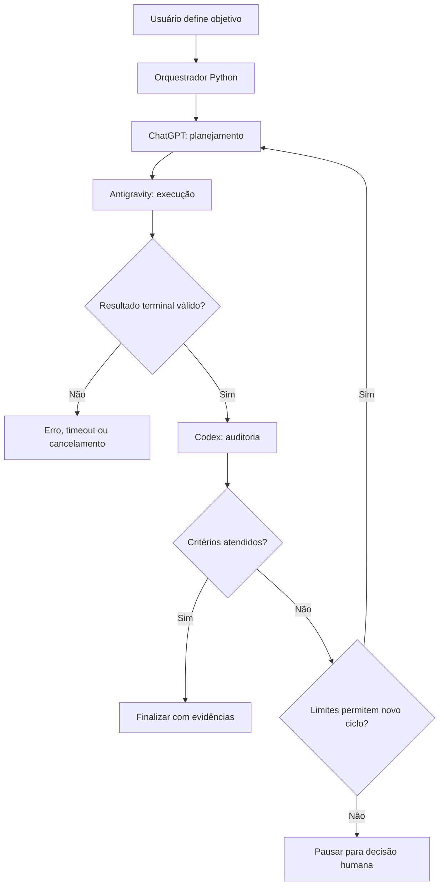

# Multi-IA Orchestrator

> **Status:** núcleo MVP e interface PySide6 disponíveis na `main`; branch Core Hardening em validação. Integrações reais continuam bloqueadas pela Task 0.

## Visão geral

O **Multi-IA Orchestrator** é um aplicativo desktop Windows em Python que coordena o ciclo **ChatGPT (planejador) → Google Antigravity (executor) → OpenAI Codex (auditor) → avaliação e próxima iteração**, sempre com limites, rastreabilidade e controle humano.

O objetivo é substituir a transferência manual de prompts e respostas entre ferramentas, mantendo evidências da execução e permitindo pausar, parar e retomar com segurança.

**Estratégia híbrida:** priorizar API, SDK e CLI oficiais; considerar automação visual apenas quando necessária, permitida e validada.

## Objetivos

- Receber do usuário o objetivo e os limites de uma execução.
- Planejar instruções estruturadas para o executor.
- Aguardar o término verificável da execução no Antigravity.
- Solicitar auditoria e testes ao Codex.
- Devolver evidências ao planejador para decidir se encerra ou inicia outro ciclo.
- Registrar prompts, resultados, comandos, testes, falhas e decisões.
- Oferecer controles de início, pausa, retomada e interrupção.

## Fluxo



Resultados parciais não podem avançar o fluxo. Cada agente recebe um resumo verificável do trabalho anterior, não apenas uma repetição textual do prompt.

## Arquitetura

| Camada | Responsabilidade | Tecnologia prevista |
|---|---|---|
| Core Engine | Estados, transições e coordenação assíncrona | Python 3.12+, asyncio |
| Agent Adapters | Integração com modelos e interfaces | API / SDK / CLI; fallback visual |
| Task Manager | Timeouts, tentativas, cancelamento | asyncio, subprocess |
| Memory Manager | Histórico e checkpoints | SQLite, JSON |
| Workspace Manager | Isolamento e inspeção de mudanças | Git, worktrees |
| Safety Controller | Aprovações, limites, permissões | Regras explícitas |
| Observabilidade | Eventos e evidências | Logs estruturados |
| Interface gráfica | Dashboard operacional, monitoramento e controles | PySide6 |

### Contratos de agentes

Cada etapa terá `run_id`, `cycle_id`, papel, tarefa, contexto, status, evidências, erros, arquivos e testes. Os contratos serão versionados e validados.

Estados terminais aceitos: `completed`, `failed` e `cancelled`; `pending` e `running` não equivalem a conclusão.

#### Retorno da auditoria ao planejador

Quando o auditor reprova um ciclo, o planejador do ciclo seguinte recebe, além do payload inicial, a chave `previous_cycle` com um resumo apenas do ciclo anterior:

| Campo | Conteúdo |
|---|---|
| `cycle_id` | Número do ciclo reprovado |
| `execution` | `evidence` e, quando informados, `artifacts`, `tests` e `write_status` |
| `audit` | `evidence`, `approved` e, quando informados, `tests_passed` e `feedback` |
| `truncated` | `true` se algum texto ou lista foi cortado |

`feedback` é opcional e, quando presente, deve ser texto; outro tipo invalida a decisão do auditor. Outros campos não são repassados. Os textos passam pela redação de segredos (melhor esforço) e são limitados a 2.000 caracteres; cada lista, a 20 itens. O resumo é montado em memória e não é gravado no banco. Seu conteúdo vem de agentes: são dados, não instruções confiáveis nem autorização para operações. A retomada pela CLI não inicia novos ciclos, portanto não reconstrói esse resumo.

### Segurança e autonomia

- Um único agente pode modificar o workspace de cada vez.
- Ações destrutivas, alterações externas e publicação exigem aprovação humana.
- Nunca alterar produção automaticamente.
- Definir limites de ciclos, tempo, tentativas e orçamento.
- Não registrar credenciais nem alegar acesso a pensamentos internos de agentes.
- Interrupção impede novas etapas; recuperação não repete escrita incerta.
- Testar inicialmente com adaptadores simulados e repositórios descartáveis.

## Plano de implantação

A execução foi detalhada em [docs/superpowers/plans/2026-11-23-multi-ia-orchestrator.md](docs/superpowers/plans/2026-11-23-multi-ia-orchestrator.md).

| Etapa | Entrega |
|---|---|
| 0 | Descoberta e decisão de integração |
| 1 | Contratos e agentes simulados |
| 2 | Máquina de estados |
| 3 | Cancelamento, timeout e aprovações |
| 4 | Persistência e checkpoints |
| 5 | Isolamento e ciclo repetível |
| 6 | Integrações reais, condicionadas à Etapa 0 |
| 7 | CLI do MVP e ensaio completo |

A interface PySide6 já foi implementada. O empacotamento e as integrações reais permanecem em fases separadas.

## Critérios de sucesso

- Ciclo completo entre três agentes com evidências.
- Detecção confiável de conclusão, falha e timeout.
- Interrupção antes da próxima etapa.
- Checkpoint consistente e recuperação segura.
- Ausência de modificações concorrentes conflitantes.
- Encerramento automático por limites ou falta de progresso.

## Decisão pendente

A integração real requer decidir entre `existing_ui` (janelas/sessões já abertas) e `independent` (sessões independentes via API/CLI). A disponibilidade, autorização, autenticação e mecanismo de término/cancelamento de cada ferramenta devem ser comprovados antes de implementar adaptadores reais.

Consulte [docs/integrations/compatibility.md](docs/integrations/compatibility.md).

## Restrições do MVP

Não pressupor acesso às mesmas conversas pela API do ChatGPT; não presumir CLI/API do Antigravity sem validação; não automatizar interfaces contrariando restrições dos fornecedores; não executar alterações na máquina do usuário a partir do GitHub sem sua instalação e autorização.

## CLI do MVP (modo fake)

Enquanto a Task 0 não validar as integrações reais, a CLI executa somente adaptadores simulados:

```powershell
python -m multi_ia.cli start --run-id demo-1 --goal "validar o fluxo" --repo .
python -m multi_ia.cli status --run-id demo-1
python -m multi_ia.cli stop --run-id demo-1
python -m multi_ia.cli resume --run-id demo-1 --goal "validar o fluxo" --repo .
```

O comando `stop` só aceita uma execução já registrada no banco em uso. Para um `run-id` desconhecido, não grava nada, informa `run_not_found` e termina com código 1.

O comando `resume` recusa automaticamente checkpoints incertos, legados sem evidência suficiente ou com workspace pendente. A confirmação de conclusão exige também um recibo de aprovação do auditor vinculado ao journal; checkpoints antigos sem recibo ficam disponíveis para consulta, mas não são considerados conclusão verificada. Somente a fronteira comprovada após confirmação do executor fake de diretório comum admite retomada de auditoria sem novo despacho.

## Modo experimental somente leitura (ferramentas reais)

Funciona apenas pelo terminal. A interface gráfica continua simulada.

```powershell
multi-ia experimental --goal "revisar o projeto e apontar erros" --repo C:\caminho\do\projeto
```

| Papel | Como funciona nesta versão |
|---|---|
| Planejador | Ponte manual: o pedido é mostrado (e copiado no Windows); você cola no ChatGPT e traz a resposta, terminando com uma linha `FIM`. Nenhum site ou aplicativo é automatizado. |
| Executor | Claude Code CLI, com `--restricted`, somente `Read,Glob,Grep`, sem personalizações nem MCP. |
| Auditor | **Você.** `s` aprova; `n` pede um comentário, que volta ao planejador no ciclo seguinte. O Codex ainda não foi validado. |

Digite `CANCELAR` no lugar de uma resposta para desistir.

Antes de começar, o comando exige que você digite `sim`. Considere:

- o Claude Code lê uma cópia temporária dos arquivos do último commit (`git archive HEAD`). Arquivos não versionados e alterações sem commit ficam de fora, mas **segredos presentes no commit podem ser enviados à Anthropic**. O que você colar no ChatGPT vai para a OpenAI. O caminho local do projeto não é incluído no pedido ao planejador;
- use somente repositórios confiáveis: o Git pode aplicar filtros configurados ao gerar a cópia, e atributos como `export-ignore` podem omitir arquivos dela;
- a restrição foi testada na versão 2.1.319 do Claude Code. Não é um sandbox do sistema; repita o teste após atualizar a CLI;
- variáveis de ambiente `CLAUDE*` e `ANTHROPIC*` não são repassadas: a CLI usa o login salvo;
- `--max-seconds` (padrão 900) limita o tempo dos agentes; a espera pelas suas respostas não conta. `--max-cycles` tem padrão 3;
- o uso consome cota ou gera custo, sem controle de orçamento pelo orquestrador;
- nada é salvo: não há `status`, `stop` nem `resume`. Copie o que quiser guardar;
- a cópia temporária é removida ao terminar e ao fechar a janela do console no Windows. Se o processo for encerrado à força, a sobra (`multi-ia-snapshot-*` na pasta temporária) só é removida na próxima execução;
- texto colado ou digitado antes da hora é descartado antes do `sim` e da sua auditoria;
- para desistir, prefira `CANCELAR`; o Ctrl+C digitado no teclado ainda não foi verificado em console real.

Este modo é uma dispensa, autorizada pelo usuário em 2026-11-25, do [gate adicional](docs/integrations/compatibility.md) **somente** para uso experimental, somente leitura, na máquina local. Não libera escrita, publicação ou produção.

### Executável para Windows

Gera um `.exe` que abre o modo experimental com um duplo clique, sem digitar o comando. Para gerar:

```powershell
python -m pip install -e ".[build]"
```

```powershell
pwsh scripts/build_exe.ps1
```

O arquivo fica em `dist\multi-ia.exe` (não é versionado). Ao abrir, ele pede a pasta do projeto (um repositório Git com pelo menos um commit; é possível arrastar a pasta para a janela) e o objetivo em uma linha. Depois segue o fluxo e os avisos acima, com 3 ciclos e 900 s de tempo dos agentes. A janela só fecha após Enter; nada é salvo em arquivo. Digite `CANCELAR` para desistir.

- Git e Claude Code, instalados e logados, continuam necessários; não vão dentro do executável.
- O arquivo não é assinado: o Windows ou o antivírus podem alertar.
- Ele é uma cópia do código no momento da geração. Depois de mudar o código, gere de novo.
- Não inclui a interface gráfica nem os comandos `start`, `status`, `stop` e `resume`. O comando `multi-ia` instalado pelo Python é outro programa, apesar do mesmo nome.

### Banco e workspace compartilhados

GUI e CLI usam o mesmo `ExecutionService` e o banco padrão `~/.multi-ia-orchestrator/runs.sqlite`. Configure `MULTI_IA_DB_PATH` para outro local; na CLI, `--db` prevalece. Bancos anteriores não são removidos nem migrados automaticamente. Para consultar um banco CLI antigo, use `--db ./multi_ia.sqlite`.

Ao selecionar um projeto Git local confiável, o serviço cria um worktree de HEAD e branch próprios, adquire o writer lock do repositório e registra a intenção de preparação antes de despachar agentes. Alterações não commitadas do checkout original não são copiadas. Worktrees limpos são removidos sem força e a branch é mantida. Operações incertas, falhas de limpeza ou interrupções preservam o worktree/lock para revisão; a retomada não adota automaticamente locks abandonados. Em diretórios não Git o fake de leitura não precisa de worktree. Não use repositórios Git desconhecidos: o Git pode executar hooks/filtros configurados pelo projeto ou ambiente.

O modo real continua desativado; nenhum grant de escrita é criado automaticamente. O botão Retomar da GUI continua sendo a retomada de pausa da sessão ativa; recuperação de processo interrompido permanece acessível via CLI. O worktree não é sandbox nem autorização para escrita real.

**Estado atual:** Tasks 1–5, CLI fake da Task 7 e interface PySide6 estão disponíveis na `main`. O único uso de ferramenta real é o modo experimental somente leitura descrito acima; não há integração automática com ChatGPT nem com Codex.


## Interface desktop PySide6

A interface visual utiliza o mesmo ExecutionService da CLI na branch de Core Hardening, mantendo somente adaptadores simulados.

### Instalação no Windows

No PowerShell, dentro do repositório:

```powershell
python -m pip install -e ".[gui]"
```

O extra `gui` instala PySide6. A linha atual do PySide6 suporta Python 3.14.

### Abrir a interface

```powershell
multi-ia-gui
```

Alternativamente:

```powershell
python -m multi_ia.gui.app
```

A janela oferece:

- objetivo da execução;
- seleção do repositório;
- máximo de ciclos;
- botões **Iniciar**, **Pausar/Retomar** e **Parar**;
- estados de ChatGPT, Antigravity e Codex;
- ciclo, cronômetro e estado geral;
- logs em tempo real;
- indicação explícita de **Modo simulado**.

O botão **Pausar** é cooperativo: a pausa acontece em limites seguros entre etapas. O tempo em que a execução fica efetivamente parada não conta no limite total de tempo; a etapa que ainda está em andamento continua contando. O cronômetro da janela mostra o tempo total, incluindo pausas. **Parar** solicita cancelamento e impede novas etapas.

> A interface ainda não controla sessões reais de ChatGPT, Antigravity ou Codex. Isso será implementado somente após a Task 0 validar os mecanismos disponíveis.

### Dashboard operacional refinado

A interface foi refinada para uso operacional diário: configuração mais compacta, fluxo visual **ChatGPT → Antigravity → Codex**, cards que mudam conforme o estado de cada agente, barra de progresso por ciclos, badge de estado destacado e painel de logs ampliado com limpeza somente visual. Uma nova execução limpa a visualização anterior dos logs sem apagar eventos ou checkpoints persistidos.
